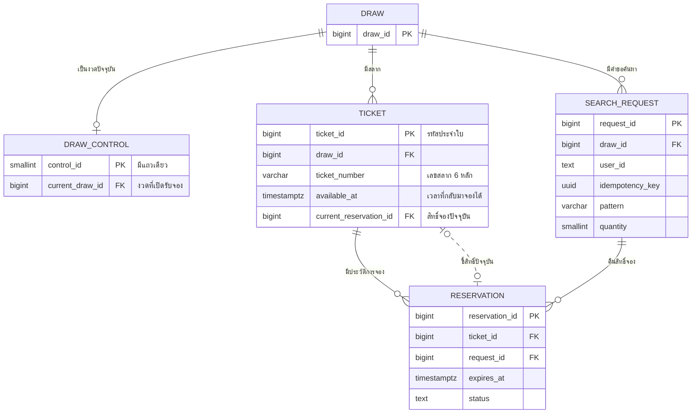
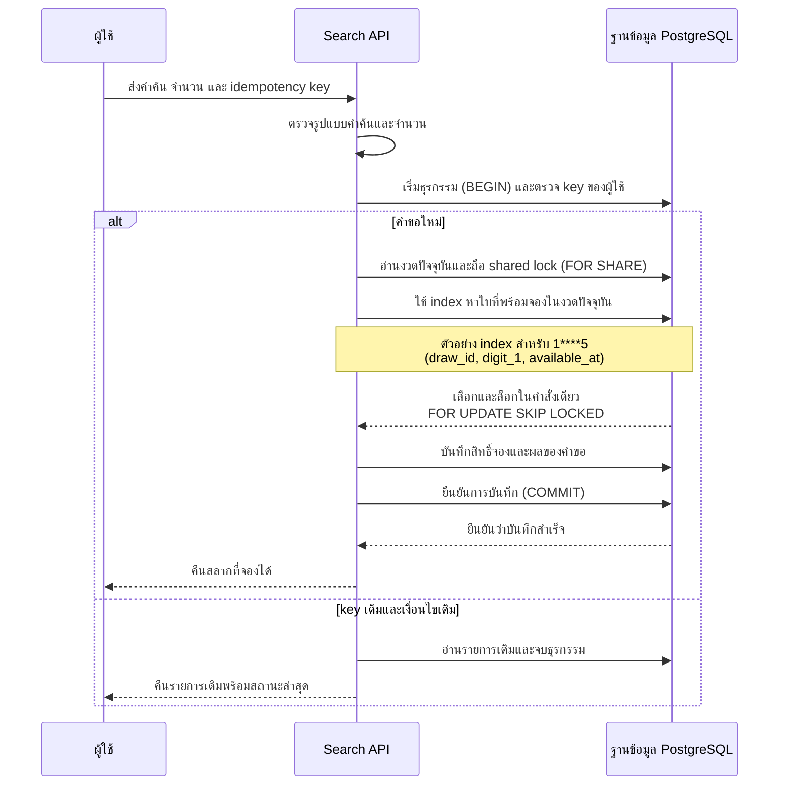
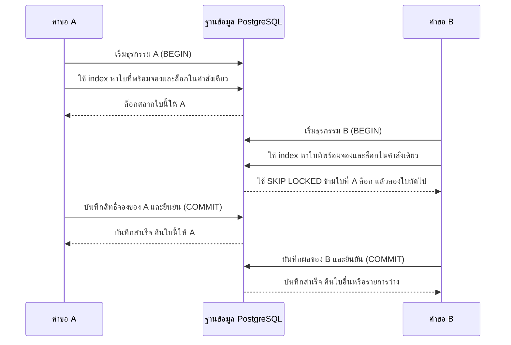
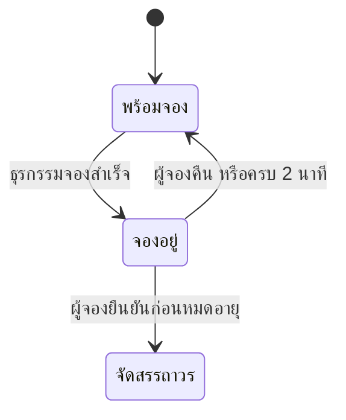
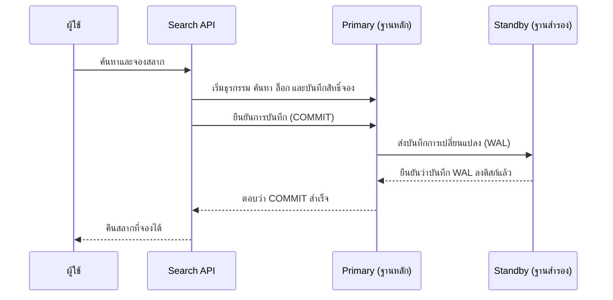

# Lottery Search System

ค้นหาและจองสลากจาก **10 ล้านใบต่องวด** ผู้ใช้ส่งรูปแบบ 6 ตำแหน่ง โดย `*` แทนตัวเลขหนึ่งหลัก เช่น `****23` ตรงกับ `000023` สลากคนละใบมีเลขเดียวกันได้ ระบบจึงแยกแต่ละใบด้วยรหัสสลาก

ระบบสร้าง **index ใน PostgreSQL** เพื่อค้นหาสลากได้เร็วขึ้น PostgreSQL ค้นหาและล็อกสลากเพื่อจองได้ในธุรกรรมเดียว API ส่งคำขอไปยังฐานหลัก ซึ่งเก็บข้อมูลงวด สลาก และประวัติการจอง

## คำศัพท์ที่ใช้ในเอกสาร

| คำศัพท์ | ความหมายในระบบนี้ |
| --- | --- |
| **Wildcard** | เครื่องหมาย `*` ที่แทนตัวเลขหนึ่งหลักในคำค้น เช่น `****23` หมายถึงเลขใดก็ได้ที่ลงท้ายด้วย `23` |
| **Index ในฐานข้อมูล / B-tree** | Index ช่วยให้ฐานข้อมูลหาแถวที่เกี่ยวข้องได้เร็วขึ้น เหมือนรายการคำท้ายหนังสือที่บอกเลขหน้า ส่วน B-tree คือรูปแบบของ index ที่จัดข้อมูลตามลำดับ จึงค้นได้ทั้งค่าตรงตัวและช่วงค่า |
| **Transaction (ธุรกรรม)** | กลุ่มงานฐานข้อมูลที่มีผลพร้อมกัน เช่น บันทึกสิทธิ์จองและผลคำขอให้สำเร็จทั้งคู่ |
| **BEGIN / COMMIT / ROLLBACK** | เริ่มธุรกรรม / ยืนยันผลการเปลี่ยนแปลง / ยกเลิกการเปลี่ยนแปลงที่ยังไม่ยืนยัน |
| **Row lock / SKIP LOCKED** | ฐานข้อมูลล็อกแถวของสลากหนึ่งใบไว้จนธุรกรรมจบ คำขออื่นที่กำลังเลือกสลากใช้ `SKIP LOCKED` เพื่อข้ามแถวนั้นไปเลือกใบถัดไปทันที |
| **Race condition** | ปัญหาที่อาจเกิดเมื่อผลขึ้นกับลำดับของงานที่แข่งกัน เช่น สองคำขอเห็นว่าสลากใบเดียวกันว่างและพยายามจองพร้อมกัน |
| **Idempotency key** | รหัสที่ผู้ใช้ส่งซ้ำกับคำขอเดิม เพื่อให้ระบบหาผลเดิมได้แม้คำตอบครั้งแรกจะหายระหว่างทาง |
| **Connection pool** | ชุดการเชื่อมต่อฐานข้อมูลที่นำกลับมาใช้ซ้ำและจำกัดจำนวนไว้ เพื่อควบคุมปริมาณงานที่เข้าฐานข้อมูลพร้อมกัน |
| **p95** | เวลาที่คำขออย่างน้อย 95% ใช้ไม่เกิน เช่น p95 อยู่ที่ 150 ms หมายถึงอย่างน้อย 95 จาก 100 คำขอเสร็จภายใน 150 ms |
| **Primary / Synchronous replication** | Primary คือฐานหลักที่รับงานเขียน ส่วน synchronous replication ในระบบนี้ให้ฐานหลักรอฐานสำรองยืนยันว่าได้รับและบันทึกข้อมูลแล้วก่อนตอบว่าธุรกรรมสำเร็จ |

## ตารางใน PostgreSQL

แผนภาพแสดงคอลัมน์หลักของแต่ละตาราง **PK** คือรหัสที่ระบุแต่ละแถว ส่วน **FK** คือรหัสที่อ้างถึงแถวในอีกตาราง

`SEARCH_REQUEST` ใช้ unique index ที่ `(user_id, idempotency_key)` เพื่อให้คำขอซ้ำอ่านผลการจองเดิมได้

### ตัวอย่างข้อมูลในแต่ละตาราง

วันที่ 19 พ.ย. 2026 เวลา 10:00 น. ผู้ใช้ A ค้น `1****5` และจองสลากหนึ่งใบในงวดปัจจุบัน

**`DRAW`** เก็บรายการงวด

| `draw_id` |
| --- |
| 101 |
| 102 |

**`DRAW_CONTROL`** มีหนึ่งแถวที่ชี้ไปยังงวดที่เปิดรับจอง

| `control_id` | `current_draw_id` |
| --- | --- |
| 1 | 101 |

**`TICKET`** แยกสลากแต่ละใบด้วย `ticket_id` แม้เลขสลากจะซ้ำกัน

| `ticket_id` | `draw_id` | `ticket_number` | `available_at` | `current_reservation_id` |
| --- | --- | --- | --- | --- |
| 1001 | 101 | `123455` | `2026-11-19 10:02+07` | 9001 |
| 1002 | 101 | `123455` | `-infinity` | `NULL` |
| 1003 | 102 | `000023` | `-infinity` | `NULL` |

**`SEARCH_REQUEST`** เก็บคำขอของผู้ใช้ A

| `request_id` | `draw_id` | `user_id` | `idempotency_key` | `pattern` | `quantity` |
| --- | --- | --- | --- | --- | --- |
| 501 | 101 | `user-A` | `01a1f1bf-2b80-7a31-8d6b-ceaf07394021` | `1****5` | 1 |

**`RESERVATION`** เชื่อมคำขอ 501 กับสลากใบ 1001

| `reservation_id` | `ticket_id` | `request_id` | `expires_at` | `status` |
| --- | --- | --- | --- | --- |
| 9001 | 1001 | 501 | `2026-11-19 10:02+07` | `reserved` |

ถ้าคำขอใหม่ค้น `1****5` ตอน 10:01 น. PostgreSQL ใช้ index เลือกงวด 101 และหลักแรก `1` แล้วตรวจเวลา ใบ 1001 ยังติดจองถึง 10:02 น. ส่วนใบ 1002 พร้อมจองทันทีเพราะ `available_at` เป็น `-infinity`

## ค้นหาอย่างไร

จองใหม่ได้เฉพาะงวดปัจจุบัน ใช้ index แบบ B-tree เพื่อจำกัดช่วงค้นหา แล้วหยุดเมื่อจองครบจำนวนที่ขอ

| รูปแบบ | ลำดับคอลัมน์ใน index ของ `TICKET` | วิธีค้น |
| --- | --- | --- |
| ระบุเลขตั้งแต่ 4 หลัก เช่น `12**45` | `(draw_id, ticket_number, available_at)` | แตกเป็นเลขเต็มที่เป็นไปได้ แล้วค้นทีละค่า |
| ระบุเลข 1–3 หลัก เช่น `1****5` | `(draw_id, digit_1, available_at)` สำหรับหลักแรก | ค้นหลักแรกที่เป็น `1` แล้วตรวจว่าหลักสุดท้ายเป็น `5` |
| `******` | `(draw_id, available_at)` | เลือกใบที่พร้อมจองในงวดนั้นโดยตรง |

`digit_1` คือค่าที่ PostgreSQL ดึงจากตัวแรกของ `ticket_number` เพื่อสร้าง index โดยตรง ทำแบบเดียวกันได้ทั้ง 6 ตำแหน่งโดยไม่ต้องเพิ่มคอลัมน์จริง ตอนค้นให้เลือกหลักที่ช่วยลดจำนวนสลากที่จะตรวจได้มากที่สุด

ภายในกลุ่มที่ค้น index จะเรียงสลากตาม `available_at` PostgreSQL จึงอ่านเฉพาะช่วงเวลาที่พร้อมจอง เมื่อยืนยันสิทธิ์ถาวร ระบบตั้ง `available_at` เป็น `NULL` และเก็บใน index เฉพาะแถวที่มีค่า `available_at` [PostgreSQL Multicolumn Indexes](https://www.postgresql.org/docs/current/indexes-multicolumn.html)

## คำค้นหนึ่งครั้งทำงานอย่างไร

ผู้ใช้ขอได้ **1–10 ใบ** ค่าเริ่มต้นหนึ่งใบ ถ้าจองได้ไม่ครบก็คืนเท่าที่จองได้ เมื่อใช้ key เดิมกับเงื่อนไขที่เปลี่ยนไปหรือส่ง key ที่พ้นช่วงเก็บประวัติ ระบบปฏิเสธคำขอ

## เมื่อสองคำขอแย่งสลากใบเดียวกัน

A ค้น `1****5` และ B ค้น `123***` พร้อมกัน ทั้งสองคำค้นตรงกับสลากใบเดียวกันเลข `123455` ในภาพ A ล็อกสลากก่อนและยังอยู่ระหว่างบันทึกการจอง

ถ้า B เข้ามาหลัง A commit PostgreSQL จะข้ามใบนั้นเพราะ A จองไว้แล้ว ถ้า A rollback ล็อกจะถูกปล่อยและคำขอถัดไปมีโอกาสจองใบนั้นได้ `FOR UPDATE SKIP LOCKED` ทำงานที่แถวสลาก จึงคุมได้แม้คำค้นต่างกัน [PostgreSQL SELECT Locking Clause](https://www.postgresql.org/docs/current/sql-select.html#SQL-FOR-UPDATE-SHARE)

## วงจรสิทธิ์จอง

เมื่อครบ **2 นาที** สลากพร้อมให้จองใหม่ตามเวลาฐานข้อมูล ระบบยืนยันหรือคืนสิทธิ์โดยล็อกแถวเดิมแล้วตรวจเวลาหมดอายุและรหัสสิทธิ์ปัจจุบัน สิทธิ์ที่ยังมีผลใช้ได้จนครบอายุแม้ระบบเปลี่ยนงวด

| เหตุการณ์ที่เกิดพร้อมกัน | ระบบจัดการอย่างไร |
| --- | --- |
| ส่งคำขอเดิมซ้ำก่อนคำขอแรกเสร็จ | คีย์ไม่ซ้ำต่อผู้ใช้ทำให้คำขอซ้ำรอผล ถ้าคำขอแรก commit ก็อ่านผลเดิม ถ้า rollback คำขอซ้ำดำเนินการต่อได้ |
| คำตอบหายหลัง commit | ส่ง key เดิมเพื่อรับรายการและงวดเดิมพร้อมสถานะล่าสุด โดยไม่จองเพิ่มหรือต่ออายุ |
| ยืนยันสิทธิ์เดิมแข่งกับการจองใหม่ | ทั้งคู่ล็อกแถวเดียวกัน ถ้ายืนยันผ่านการตรวจทันเวลา ใบนั้นจะจัดสรรถาวร ถ้าสิทธิ์หมดอายุหรือใบถูกจองใหม่แล้ว การยืนยันเดิมจะถูกปฏิเสธ |
| เปลี่ยนงวดระหว่างรับคำขอ | คำขอจองหลายรายการอ่านแถว `DRAW_CONTROL` ด้วย shared lock (`FOR SHARE`) พร้อมกันได้ และถือล็อกจนธุรกรรมจบ เมื่อเปลี่ยนงวด คำสั่ง `UPDATE` จะรอให้ล็อกเหล่านี้ถูกปล่อยก่อนแก้แถว |

## ประสิทธิภาพและข้อแลกเปลี่ยน

เมื่อคำขอเข้ามาพร้อมกันจำนวนมาก ให้จำกัดจำนวนธุรกรรมด้วย connection pool และทำงานในล็อกให้สั้น เมื่อฐานข้อมูลตอบไม่ทันให้คืนข้อผิดพลาดที่ลองใหม่ได้ด้วย key เดิม ถ้าผล commit ไม่แน่ชัด key เดิมจะใช้ตรวจผล หากคำค้นทำงานเสร็จและข้ามทุกใบที่กำลังถูกล็อก ผลอาจว่างได้แม้สลากยังเหลือ

- **`12**45`** มี wildcard สองหลัก จึงลองค้นเลขเต็มผ่าน index ได้สูงสุด **100 ค่า** และหยุดเมื่อจองครบ
- **`1****5`** ใช้ index เลือกกลุ่มที่ขึ้นต้นด้วย `1` แล้วตรวจว่าลงท้ายด้วย `5` ถ้าเลขกระจายสม่ำเสมอ กลุ่มนี้มีประมาณ **หนึ่งในสิบ** ของสลากทั้งหมด เมื่อสต็อกเหลือน้อยอาจต้องอ่านหลายใบในกลุ่มกว่าจะจองครบ

การมีหลาย index ช่วยให้ค้นได้หลายรูปแบบ โดยใช้พื้นที่เพิ่มและต้องอัปเดต index ทุกครั้งที่จอง

ทดสอบกับข้อมูล 10 ล้านใบที่เป้าหมาย **300 คำค้นต่อวินาที และ p95 ไม่เกิน 150 ms** รวมเวลาจอง ทดสอบทั้งคำค้นกว้าง สลากเหลือน้อย และผู้ใช้แย่งใบเดียวกัน ตรวจทั้งเวลา จำนวนคำขอที่สำเร็จ และประวัติว่าช่วงจองของสลากใบเดียวกันไม่ทับซ้อนกัน ตัวเลขนี้เป็นเป้าหมายที่ต้องวัด

## ฐานข้อมูลใน Production

การค้นหาและจองสลากอ่านและเขียนที่ **Primary** ในธุรกรรมเดียว ส่วน **Standby** รับสำเนาข้อมูลเพื่อใช้เป็นฐานสำรอง

Primary รอ Standby ยืนยันก่อนตอบว่าบันทึกสำเร็จ หากต้องสลับฐานหลัก ให้เปิดรับจองเมื่อยืนยันได้ว่า Standby มีข้อมูลที่ commit ครบและฐานหลักเดิมหยุดเขียนแล้ว [PostgreSQL Synchronous Replication](https://www.postgresql.org/docs/current/warm-standby.html#SYNCHRONOUS-REPLICATION)

[คำศัพท์เกี่ยวกับสลาก](../CONTEXT.md) · [ADR การจองเมื่อคืนผล](adr/0001-reserve-tickets-on-search.md) · [ADR การเลือก PostgreSQL](adr/0002-postgresql-for-lottery-allocation.md)
